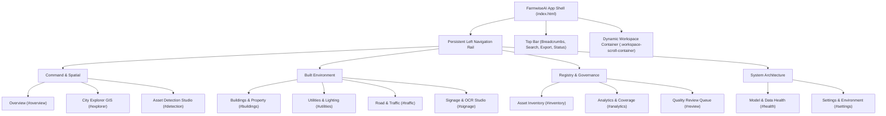

# FarmwiseAI Project 2 — Page and Navigation Map

**Architecture:** Single Page Application (SPA) with Client-Side Hash Routing  
**Target Domain:** Coimbatore City Municipal Corporation (CCMC) — Ward 29 Digital Twin  
**Base Path:** `d:\farm ai\dashboard_redesign_prototype\index.html`  

---

## 1. Global Navigation Architecture

The interface uses a **persistent responsive left navigation rail/sidebar** (260px wide, collapsible to a 76px compact icon rail, and converting into an off-canvas drawer on mobile `<768px`) combined with a **compact top header bar** (64px high) providing breadcrumbs, global search, status pills, and export shortcuts.

---

## 2. Workspace Routes & Functional Capabilities

### A. Command & Spatial
1. **Overview (`#overview`):**
   - Executive landing page summarizing the 2.49 km surveyed network, 465 fixed infrastructure assets, 108 street frames, and ₹20.40 L commercial revenue potential.
   - Interactive mini-map preview showing the Ward 29 polygon boundary and 10 corridor lines.
   - Immediate municipal safety alerts (33 P1 electrical defects, 18 streetlight dark spots).
   - Clickable KPI cards deep-linking to respective detailed pages.

2. **City Explorer GIS (`#explorer`):**
   - Dedicated map-first workspace with Leaflet GIS engine on CartoDB Positron clean tiles.
   - Corridor selection dropdown zooming to individual street transects (ST01 to ST10).
   - Independent layer toggles with color-coded badges (Poles, Streetlights, Transformers, Signals, Buildings).
   - Click-to-inspect asset detail drawer displaying full 32-parameter digital passports, nearest infrastructure vectors, and visual evidence.
   - Reset boundary view and interactive distance measurement tools.

3. **Asset Detection Studio (`#detection`):**
   - Frame-by-frame street view inspection canvas with high-resolution captures.
   - Bounding box overlay toggle with class-specific colors.
   - Confidence threshold slider (0% to 100%) and class selector filter.
   - Detections table with explicit audit badges distinguishing confirmed records from predictions awaiting verification.

---

### B. Built Environment
4. **Buildings & Property (`#buildings`):**
   - Catalog of 108 building parcels with floor classifications ($G$ to $G+4$).
   - Height gauges ($3.5\text{ m} \times \text{floors}$ with explicit provenance disclosure).
   - Commercial facade typologies and establishment names.
   - Google Maps search links and OCR signboard associations.
   - Prominent cadastral disclaimer separating visual frontage from legal tax parcel deeds.

5. **Utilities & Lighting (`#utilities`):**
   - 3-tier utility ledger: 108 Electric Utility Poles, 108 Streetlights, 24 Transformers.
   - TANGEDCO work orders table with P1-Critical, P2-High, and P3-Routine filters.
   - Photometric infill locations for CCMC streetlight spacing compliance (IRC:SP:72).
   - CSV export for municipal utility engineering teams.

6. **Road & Traffic (`#traffic`):**
   - Comparative intelligence scorecard for all 10 surveyed road corridors.
   - Cable Burden Index (CBI) vs Street Lighting Adequacy (SLAS) vs Municipal Grades.
   - Traffic signals status across signalized commercial junctions.
   - Explicit documentation regarding transient vehicle filtering and roadside tree status.

7. **Signage & OCR Studio (`#signage`):**
   - Searchable catalog of 201 commercial signboards across 11 economic sectors.
   - Inverted search bar querying over 220 extracted keywords.
   - Trade sector filter and EasyOCR confidence scores.
   - Direct connection to CCMC commercial tax ledger valuations.

---

### C. Registry & Governance
8. **Asset Inventory (`#inventory`):**
   - Master searchable, sortable, paginated table of all 465 fixed infrastructure assets.
   - Multi-facet filters by Class, Corridor, Physical Condition, and Maintenance Priority.
   - Functional client-side CSV export and GeoJSON download.
   - Detail slide-out inspection drawer on row click.

9. **Analytics & Coverage (`#analytics`):**
   - Visual distribution graphs for asset classes and corridor densities.
   - Defect severity breakdown and commercial tax revenue yields.
   - Honest model evaluation metrics comparison (Precision vs Recall vs mAP@50).

10. **Quality Review (`#review`):**
    - Active review queue for 8 flagged observations (data quality alerts, formula bboxes, critical electrical hazards).
    - Reviewer action buttons (Accept Observation, Flag for Re-survey).
    - Reviewer notes input with browser `localStorage` persistence.

---

### D. System Architecture
11. **Model & Data Health (`#health`):**
    - Verified model checkpoint registry with SHA-256 hashes (`yolo11n.pt`, `best.pt`, `best.onnx`).
    - 5-epoch training loss trajectories and Ultralytics validation performance.
    - Honest reporting of the 0.34% precision and 7.48% mAP50 baseline.
    - Edge ONNX benchmark (42.01 ms CPU) and AWS serverless testbench conformance.

12. **Settings & Context (`#settings`):**
    - Municipal study domain metadata (CCMC Ward 29, North Zone, WGS84).
    - Live data source integration status badges.
    - Zero exposed credentials or API keys.
