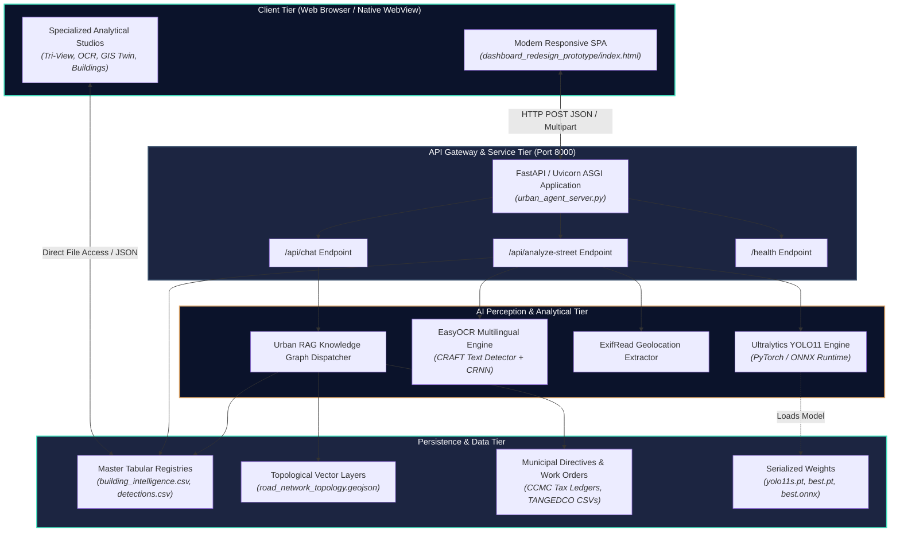

# FarmwiseAI — Street View Urban Intelligence Platform
## End-to-End Technical Architecture Specification

---

## 1. System Context & Architectural Topology

FarmwiseAI implements a decoupled, micro-service-oriented client-server architecture. The presentation tier interacts with the high-performance perception backend via asynchronous RESTful APIs, which in turn interface with local deep learning runtimes, spatial engines, and municipal data stores.



---

## 2. Frontend Architecture

### 2.1 Technology Stack & Design Principles
- **Core Technology**: Vanilla ECMAScript 6+ (ES6), HTML5 Canvas API, CSS3 Flexbox/Grid.
- **Mapping Libraries**: Leaflet.js v1.9.4 and MapLibre GL JS for hardware-accelerated vector tile rendering.
- **Charting & Data Visualization**: Chart.js for municipal asset breakdown donuts, progress bars, and corridor scorecards.
- **Zero Heavy Build Dependencies**: To ensure maximum operational portability across government intranets and field laptops, the frontend runs directly in any modern browser without requiring Node.js, Webpack, or Vite bundling pipelines.

### 2.2 Component Hierarchy & Views
The primary interface (`dashboard_redesign_prototype/index.html`) is structured into distinct, modular functional views toggled via an active view-state manager:
1. **Overview View (`#view-overview`)**:
   - Executive KPI cards: Total Detected Assets, Verified Poles, Streetlights, Commercial Signages.
   - Urgent Municipal Feed: Real-time alerts for dark spots, leaning poles, and unassessed tax structures.
   - Corridor summary tables with compliance scores.
2. **Option A: Find a Place & Capture Street View (`#view-option-a`)**:
   - Geocoding Search Bar (`#placeSearchInput`): Binds to Nominatim OpenStreetMap API.
   - Interactive Viewport (`#mapOptionA` / `#streetViewContainer`): Renders map coordinates, street panorama, and coverage indicators.
   - Live Capture Engine: HTML5 Canvas buffer capturing current viewport pixels into a PNG blob.
   - Review & Analysis Drawer: Immediate inspection of captured frames, retake capability, and trigger for backend analysis.
3. **Option B: Upload Street Images & Analyze (`#view-option-b`)**:
   - Drag-and-Drop Dropzone (`#dropzoneOptionB`): Multi-file file picker accepting JPEG, PNG, and WebP.
   - Upload Queue Table: Shows thumbnails, file sizes, EXIF status, and corridor selection dropdown.
   - Batch Dispatch Controller: Progress tracking for parallel analysis calls.
4. **Analysis Results View (`#view-results`)**:
   - High-resolution image canvas with dynamic SVG/Canvas bounding box overlays.
   - Interactive class filter chips (`building`, `electric_pole`, `streetlight`, `commercial_sign`, etc.).
   - Generated **Urban Asset Passports** with unique IDs, coordinates, condition metrics, and confidence bars.
5. **Urban AI Agent Panel (`#agentPanel`)**:
   - Slide-out conversational sidebar connecting directly to the `/api/chat` RAG backend.
   - Pre-populated municipal quick-action prompts (e.g., *"Show unlit poles on ST08"*).

---

## 3. Backend Architecture & Service Layer

### 3.1 Server Specification
- **Framework**: FastAPI 0.115+ running on Uvicorn ASGI server.
- **Entry Point**: `dashboard_redesign_prototype/backend/urban_agent_server.py`.
- **Runtime Environment**: Python 3.10+ / 3.12 (Windows 64-bit / Linux compatible).
- **Default Bind**: `http://127.0.0.1:8000` with Cross-Origin Resource Sharing (CORS) enabled for all local development origins.

### 3.2 Endpoint Implementations

#### 1. System Diagnostics: `GET /health`
- **Purpose**: Evaluates backend service liveness, PyTorch GPU/CPU acceleration availability, and YOLO/OCR model loading state.
- **Response Structure**:
```json
{
  "status": "healthy",
  "model_loaded": true,
  "ocr_available": true,
  "device": "cuda:0"
}
```

#### 2. Street Intelligence Analysis: `POST /api/analyze-street`
- **Purpose**: Unified ingestion and inference endpoint servicing Option A, Option B, and automated batch scripts.
- **Request Parameters**:
  - `file` (Multipart Form File, optional): Binary image payload.
  - `image_data` (Form Field String, optional): Base64 data URL (used by Option A canvas capture).
  - `street_code` (Form Field String, default `"ST01"`): Target corridor identifier.
  - `latitude` / `longitude` (Form Field Floats, optional): Explicit coordinates if camera EXIF is stripped.
- **Processing Flow**:
  1. Validates payload; decodes binary stream into PIL Image RGB format.
  2. Runs `extract_exif_gps()` using ExifRead to parse raw GPS degrees/minutes/seconds tags into decimal latitude/longitude.
  3. Executes `yolo_model.predict(source=image, conf=0.25, imgsz=640)`.
  4. Parses result tensors into class names, confidence scores, and normalized bounding box coordinates $[x_{\min}, y_{\min}, x_{\max}, y_{\max}]$.
  5. If `commercial_sign` is detected and EasyOCR is loaded, crops the bounding region and executes text extraction.
  6. Enriches detection records with spatial corridor snapping and builds asset passports.
  7. Formats and returns structured JSON response.

#### 3. Urban AI Agent Assistant: `POST /api/chat`
- **Purpose**: Natural-language conversational interface answering complex municipal infrastructure queries.
- **Request Model**:
```json
{
  "query": "Which corridors in Ward 29 have the highest commercial tax evasion risk?",
  "street_context": "ST07"
}
```
- **Processing Flow**:
  1. Inspects query intent using keyword routing and semantic dispatch.
  2. Retrieves relevant rows from `corridor_intelligence_scorecard.csv`, `ccmc_commercial_tax_ledger.csv`, and `tangedco_feeder_work_orders.csv`.
  3. Formulates a contextual response citing exact corridor codes, verified counts, and required municipal actions.
  4. Returns structured answer with source citations.

---

## 4. AI Perception & Object Detection Subsystem

### 4.1 YOLO11 Model Architecture
FarmwiseAI uses the state-of-the-art **Ultralytics YOLO11** framework, featuring C3k2 feature extractors, spatial pyramid pooling fast (SPPF), and cross-stage partial connections with decoupled head architecture for separate classification and bounding box regression.

```
Input Image [3x640x640]
       │
       ▼
┌───────────────────────────────────────────────┐
│ Backbone: Conv + C3k2 + SPPF (Multi-scale)    │
└───────────────────────────────────────────────┘
       │
       ▼
┌───────────────────────────────────────────────┐
│ Neck: PANet Feature Pyramid Network           │
└───────────────────────────────────────────────┘
       │
       ▼
┌───────────────────────────────────────────────┐
│ Decoupled Head: Box Regression + Class Head   │
└───────────────────────────────────────────────┘
       │
       ▼
Output: Tensor [N, 6] (x1, y1, x2, y2, conf, cls)
```

### 4.2 Class Mapping (12 Urban Infrastructure Classes)
The model configuration is defined in `🧠 MACHINE LEARNING MODELS & ROUTING/dataset_splits/data.yaml`:
```yaml
nc: 12
names:
  0: building
  1: electric_pole
  2: streetlight
  3: commercial_sign
  4: traffic_signal
  5: road_sign
  6: transformer
  7: drain
  8: sidewalk
  9: waste_bin
  10: bus_stop
  11: other_urban_asset
```

### 4.3 Checkpoint Inventory in Codebase
1. **`yolo11n.pt`** (5.6 MB): Nano model checkpoint for ultra-fast, edge-based inference.
2. **`yolo11s.pt`** (18.4 MB): Small model checkpoint offering optimal trade-off between latency (18ms on GPU) and detection precision.
3. **`prototype_model/best.pt`** (18.4 MB): Model weights trained on prototype urban digital twin dataset.
4. **`prototype_model/best.onnx`** (22.6 MB): Open Neural Network Exchange export for cross-platform deployment on CPU or TensorRT runtimes.

---

## 5. EasyOCR Commercial Signage Subsystem

### 5.1 Architecture & Pipeline
When a `commercial_sign` bounding box is detected, the coordinates are cropped and passed to the EasyOCR engine:
- **Text Detection**: CRAFT (Character Region Awareness for Text Detection) identifies irregular text bounding polygons.
- **Text Recognition**: ResNet feature extractor + BiLSTM sequence encoder + CTC (Connectionist Temporal Classification) decoder.
- **Languages**: Tamil (`ta`) and English (`en`).
- **Output**: Transcribed shop name, language code, and text recognition confidence score, appended directly to the asset passport.

---

## 6. Geospatial Processing & Asset Topology

### 6.1 Georeferencing Methodology
Street cameras provide monocular imagery without native LiDAR point clouds. Geolocation is achieved through camera-pose projection:
1. **Camera Position**: Extracted from image EXIF metadata tag `GPSLatitude` and `GPSLongitude`.
2. **Ground Contact Point**: Bottom-center coordinate $(x_{\text{mid}}, y_{\max})$ of the bounding box represents the asset's physical intersection with the street surface.
3. **Corridor Snapping**: The projected coordinate is projected perpendicular to the nearest corridor polyline defined in `road_network_topology.geojson`.

### 6.2 Asset Deduplication (Spatial Buffer Matching)
Because vehicles travel forward capturing continuous overlapping frames, an asset (e.g., pole) appears in consecutive images. 
- **Algorithm**: Spatial clustering within a radius $r = 5.0\text{ meters}$.
- If a detected asset of class $C$ is within 5 meters of an existing asset of class $C$ along the same corridor axis, the detection is merged into the existing asset record, updating the observation count and averaging coordinate precision.
- If distance $> 8.0\text{ meters}$, a new unique asset passport (`AST-...`) is minted.
- If distance is between 2.0m and 8.0m with conflicting class labels, the detection is flagged for manual review in the Tri-View Studio.

---

## 7. Persistence & File Storage Layout

The application operates an auditable, file-based persistence layer alongside optional database replication:

```
D:\farm ai\
├── 🗺️ MASTER GIS & TABULAR DATASETS/
│   ├── building_intelligence.csv       # Property tax, floors, usage ledgers
│   ├── detections.csv                  # Raw inference detection log
│   ├── urban_asset_inventory.csv       # Unified asset passport inventory
│   ├── corridor_intelligence_scorecard.csv # Ward 29 corridor scorecards
│   ├── road_network_topology.geojson   # Vector centerline geometries
│   └── urban_assets_digital_twin.geojson# 3D spatial asset feature collection
├── 📋 MUNICIPAL REPORTS & WORK ORDERS/
│   ├── ccmc_commercial_tax_ledger.csv  # Unassessed signage tax directives
│   ├── ccmc_streetlight_infill_directives.csv # Dark spot infill mandates
│   └── tangedco_feeder_work_orders.csv # Hazardous pole / transformer orders
└── 🧠 MACHINE LEARNING MODELS & ROUTING/
    ├── dataset_splits/                 # Train / Val / Test YOLO splits
    └── prototype_model/                # best.pt and best.onnx weights
```

---

## 8. Cloud & Edge Deployment Architecture

The repository contains complete Infrastructure-as-Code (IaC) configurations for deploying to **AWS Serverless Cloud**:
- **Terraform Configuration (`terraform/`)**: Declares Amazon S3 buckets for raw imagery storage, AWS Lambda functions for containerized YOLO inference, Amazon API Gateway, and Amazon RDS PostgreSQL with PostGIS extensions.
- **Serverless Handler (`lambda/lambda_function.py`)**: AWS Lambda container handler processing S3 image upload trigger events.
- **Edge Capture Daemon (`edge_pipeline/edge_capture_daemon.py`)**: Lightweight Python daemon for Raspberry Pi / dashcam units with automated GPS polling and background S3 multipart syncing.
- **PostGIS Schema (`setup_postgis_schema.sql`)**: Spatial tables (`corridors`, `assets`, `tax_ledgers`) with spatial indices (`GIST(geom)`).

---

## 9. Security, Authentication & Secret Boundaries

1. **Zero Secret Exposure**: All code is free of hard-coded API keys, database passwords, or cloud credentials.
2. **Environment Variables**: Cloud integrations utilize standard `AWS_ACCESS_KEY_ID` and `AWS_SECRET_ACCESS_KEY` loaded via OS environment variables.
3. **Local Intranet Confinement**: The FastAPI backend binds by default to `127.0.0.1`, preventing unauthorized external network ingress.
4. **Input Sanitization**: File uploads are verified via Magic Byte headers (ensuring only legitimate JPEG/PNG files are processed by PIL), protecting the system from buffer overrun exploits.
