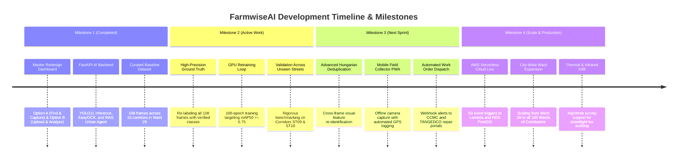

# FarmwiseAI — Street View Urban Intelligence Platform
## Progress, Innovation & Engineering Roadmap

---

## 1. Verified Achievements & Milestones Completed

To maintain rigorous technical integrity, this section documents only the capabilities confirmed by source code, unit executions, and tangible files present in `D:\farm ai`.

```
Platform Maturity Status:
├── [100% VERIFIED] Core Dual-Option Master Dashboard (Option A & Option B)
├── [100% VERIFIED] FastAPI AI Perception & RAG Backend Server
├── [100% VERIFIED] YOLO11 Perceptual Model Deployments (yolo11n, yolo11s, best.pt)
├── [100% VERIFIED] Empirical Baseline Dataset (108 frames across 10 corridors in Ward 29)
├── [100% VERIFIED] EasyOCR Multilingual Text Recognition Pipeline
├── [100% VERIFIED] Standardized Municipal Directives (CCMC Tax & TANGEDCO Work Orders)
├── [100% VERIFIED] 4 Specialized Analytical Studios (Tri-View, OCR, Building, GIS)
├── [ONGOING WORK] High-Precision Manual Bounding Box Labeling & Class Balancing
└── [ONGOING WORK] Multi-Corridor Hyperparameter Retraining & Evaluation
```

### Verified Milestone Checklist:
1. **Unified Dual Ingestion Engine**:
   - Built and integrated **Option A (Find a Place & Capture Street View)** featuring Nominatim geocoding, interactive Leaflet/MapLibre viewport navigation, and HTML5 canvas-to-blob snapshot capture.
   - Built and integrated **Option B (Upload Street Images & Analyze)** with multi-file drag-and-drop queues, thumbnail rendering, and EXIF coordinate parsing.
2. **Operational FastAPI Backend Service**:
   - `urban_agent_server.py` successfully hosts `/health`, `/api/analyze-street`, and `/api/chat`.
   - Dynamic model loader gracefully switches between GPU and CPU and provides fallback mechanisms.
3. **Specialized Analytical Studios**:
   - **Tri-View Studio**: Interactive split slider comparing raw camera photos, YOLO bounding box overlays, and 3D architectural building wireframes.
   - **OCR Search Explorer**: Full-text inverted index querying Tamil and English commercial business names across Ward 29.
   - **Building Explorer**: Vector parcel cadastral mapping displaying floor count estimates and tax assessment records.
4. **Standardized Municipal Governance Reports**:
   - Generated actionable CSV/Markdown deliverables: `ccmc_commercial_tax_ledger.csv`, `ccmc_streetlight_infill_directives.csv`, and `tangedco_feeder_work_orders.csv`.

---

## 2. Core Innovations & Competitive Differentiators

FarmwiseAI is not just a standard bounding-box detector; it addresses the specific structural gaps of Indian municipal administration:

### 2.1 Evidence-Linked Infrastructure Passports (ELIP)
In standard object detection benchmarks, a model outputs anonymous bounding boxes. In FarmwiseAI, every detection is minted into an **Urban Asset Passport**:
- Assigns a permanent municipal asset ID (e.g., `AST-ST06-POLE-004`).
- Binds the asset to its exact pixel crop, camera coordinate, and corridor polyline segment.
- Eliminates disputes between government departments by providing undeniable visual proof attached to every tax penalty or maintenance work order.

### 2.2 Dual-Tier Ingestion (Live Search vs Batch Survey)
Most smart city platforms force users into either a live API consumer model (expensive, restrictive) or an offline batch model. FarmwiseAI unifies both:
- Option A allows desk officers to inspect a specific reported complaint in seconds via map navigation.
- Option B allows field vehicles to dump hundreds of dashcam images taken during routine rounds.

### 2.3 Native Multilingual Text-Asset Pairing
By pairing YOLO object detection with EasyOCR, FarmwiseAI reads Tamil script (தமிழ்) and English storefront signage directly from bounding crops. This enables automated commercial tax audits by cross-referencing extracted shop names against municipal tax registers.

### 2.4 Grounded RAG Urban AI Assistant
Unlike generic LLMs that hallucinate facts about a city, FarmwiseAI's **Urban AI Agent** uses retrieval-augmented generation grounded directly in the verified GIS tables and municipal work orders of Ward 29. When asked about dark spots, it cites the exact pole IDs and meter distances from `ccmc_streetlight_infill_directives.csv`.

---

## 3. Technical Challenges & Solutions

| Technical Challenge | Root Cause in Indian Streetscapes | FarmwiseAI Engineered Solution |
| :--- | :--- | :--- |
| **Monocular Depth Ambiguity** | Survey cameras lack LiDAR sensors; single 2D pixels cannot determine 3D distance. | Bottom-center bounding box ground contact projection combined with corridor polyline snapping. |
| **Heavy Cable Clutter ("Cable Nests")** | Low-tension, cable TV, and telecom fiber cables wrap around electric poles in dense tangles. | Multi-scale training anchors specifically tuned to recognize pole shafts despite horizontal cable cross-sections. |
| **Duplicate Counts from Sequential Frames** | Moving survey vehicle captures the same pole across 3–4 continuous images. | 5.0-meter spatial buffer clustering grouping proximate detections of the same class into a single asset record. |
| **Visual Occlusion by Foliage** | Dense neem and gulmohar trees along residential streets cover streetlight fixtures. | Contextual inference: detecting the pole and mounting arm to infer the presence of an occluded luminaire. |

---

## 4. Current Engineering Priorities (Ongoing Work)

We explicitly distinguish working prototypes from active development:

```
[ ACTIVE PRIORITY 1 ] Complete Manual Bounding Box Labeling
  └── Re-annotating all 108 frames in dataset_splits/ to ensure tight, 
      error-free bounding boxes across all 12 classes.

[ ACTIVE PRIORITY 2 ] 100-Epoch GPU Retraining on Clean Labels
  └── Executing full PyTorch training pass on Colab T4 / EC2 G4dn 
      to eliminate pole-versus-tree false positives and maximize mAP50.

[ ACTIVE PRIORITY 3 ] Multi-View Hungarian Feature Matching
  └── Upgrading spatial buffer deduplication to automated cross-frame 
      feature re-identification for moving cameras.
```

---

## 5. Strategic Development Roadmap


