# FarmwiseAI — Visual Architecture & Flowchart Gallery
## Complete Collection of High-Resolution System Flowcharts & Diagrams

This document provides direct viewable images for all 12 architectural flowcharts and system diagrams created for the FarmwiseAI Street View Urban Intelligence Platform.

Both high-resolution PNG image files and editable Mermaid `.mmd` source files are located in:
`D:\farm ai\project_documentation\diagrams\`

---

## 1. Overall System Architecture (Diagram 1)

**File Path**: [`diagrams/01_overall_architecture.png`](file:///D:/farm%20ai/project_documentation/diagrams/01_overall_architecture.png)  
**Mermaid Source**: [`diagrams/01_overall_architecture.mmd`](file:///D:/farm%20ai/project_documentation/diagrams/01_overall_architecture.mmd)

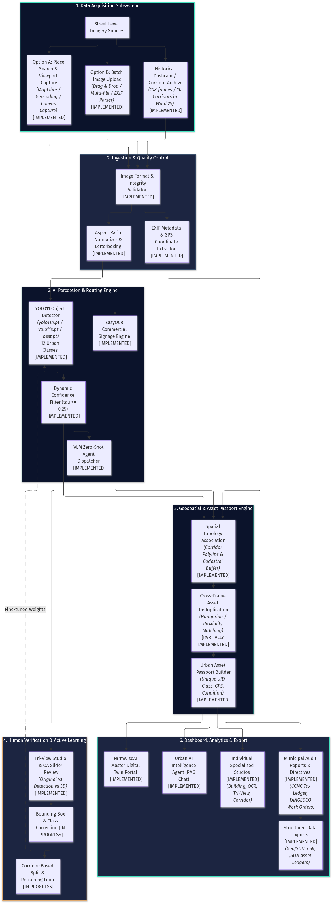

> **Architectural Description**: This is the primary end-to-end blueprint of FarmwiseAI. It details the 6 major subsystems:
> 1. **Data Acquisition Subsystem**: Option A (Map/Canvas Capture), Option B (Multi-frame Upload), and Historical Archive.
> 2. **Ingestion & Quality Control**: Payload validation, EXIF GPS parsing, and image normalization.
> 3. **AI Perception & Routing Engine**: Ultralytics YOLO11 (12 classes), confidence filtering, EasyOCR, and VLM zero-shot routing.
> 4. **Human Verification & Active Learning**: Tri-View QA slider, ground-truth label adjustment, and retraining loop.
> 5. **Geospatial & Asset Passport Engine**: Polyline snapping, 5m spatial buffer deduplication, and UID generation.
> 6. **Presentation & Reporting**: Master Portal, Urban AI Agent, Standalone Studios, CCMC Tax Ledgers, and TANGEDCO Work Orders.

---

## 2. High-Level System Context (Diagram 2)

**File Path**: [`diagrams/02_system_context.png`](file:///D:/farm%20ai/project_documentation/diagrams/02_system_context.png)  
**Mermaid Source**: [`diagrams/02_system_context.mmd`](file:///D:/farm%20ai/project_documentation/diagrams/02_system_context.mmd)

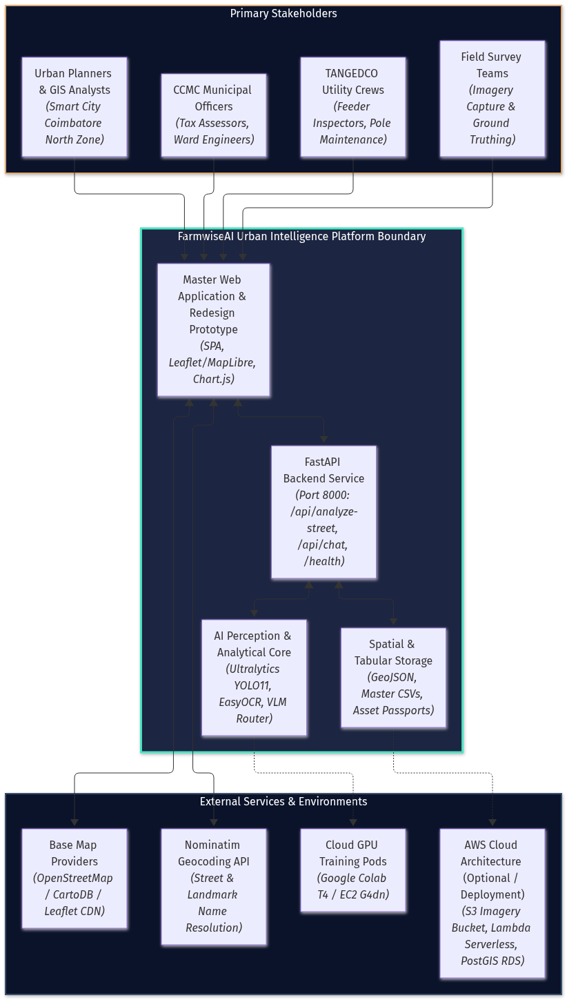

> **Architectural Description**: Shows the operational trust boundaries and information flows between primary stakeholders (CCMC municipal officers, TANGEDCO utility crews, urban planners, field surveyors), the FarmwiseAI platform boundary, and external base map / cloud compute environments.

---

## 3. Application Component Architecture (Diagram 3)

**File Path**: [`diagrams/03_component_architecture.png`](file:///D:/farm%20ai/project_documentation/diagrams/03_component_architecture.png)  
**Mermaid Source**: [`diagrams/03_component_architecture.mmd`](file:///D:/farm%20ai/project_documentation/diagrams/03_component_architecture.mmd)

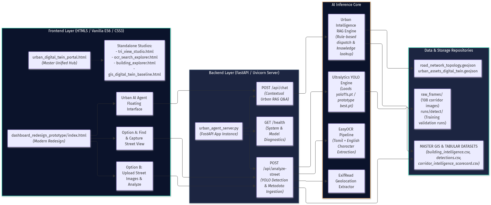

> **Architectural Description**: Maps the relationship between frontend presentation views (`index.html`, Option A, Option B, Agent Modal, Standalone Studios), backend service routers (`urban_agent_server.py`), inference engines, and persistent file repositories (`road_network_topology.geojson`, CSV ledgers).

---

## 4. Image-to-Asset Detection Flowchart (Diagram 4)

**File Path**: [`diagrams/04_detection_pipeline.png`](file:///D:/farm%20ai/project_documentation/diagrams/04_detection_pipeline.png)  
**Mermaid Source**: [`diagrams/04_detection_pipeline.mmd`](file:///D:/farm%20ai/project_documentation/diagrams/04_detection_pipeline.mmd)

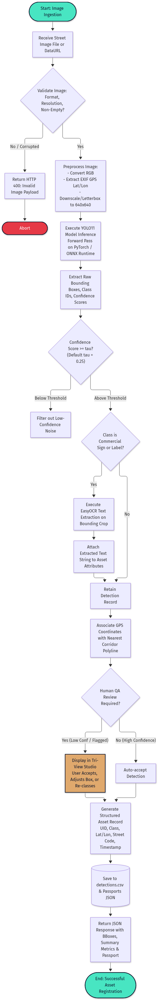

> **Architectural Description**: Follows a single frame through image validation, RGB conversion, EXIF coordinate extraction, YOLO11 inference pass, confidence threshold gating ($\tau \ge 0.25$), EasyOCR text crop extraction, human review routing, and final asset record persistence.

---

## 5. Dataset Annotation & Model Training Flow (Diagram 5)

**File Path**: [`diagrams/05_annotation_training_flow.png`](file:///D:/farm%20ai/project_documentation/diagrams/05_annotation_training_flow.png)  
**Mermaid Source**: [`diagrams/05_annotation_training_flow.mmd`](file:///D:/farm%20ai/project_documentation/diagrams/05_annotation_training_flow.mmd)

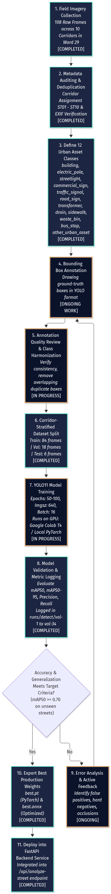

> **Architectural Description**: Illustrates the iterative training lifecycle, explicitly highlighting active manual bounding box re-annotation across the 108 corridor frames, corridor-stratified train/val/test splits (zero data leakage), 100-epoch GPU retraining, and prototype validation passes logged in `runs/detect/`.

---

## 6. Street-Level Data Acquisition (Diagram 6)

**File Path**: [`diagrams/06_data_acquisition.png`](file:///D:/farm%20ai/project_documentation/diagrams/06_data_acquisition.png)  
**Mermaid Source**: [`diagrams/06_data_acquisition.mmd`](file:///D:/farm%20ai/project_documentation/diagrams/06_data_acquisition.mmd)

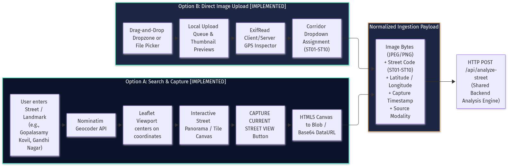

> **Architectural Description**: Details the dual-modality ingestion pipeline: Option A (Nominatim geocoding $\to$ Leaflet viewport $\to$ HTML5 canvas snapshot) and Option B (drag-and-drop dropzone $\to$ EXIF GPS parser $\to$ corridor assignment queue), merging into a normalized backend analysis payload.

---

## 7. Geospatial Asset Inventory (Diagram 7)

**File Path**: [`diagrams/07_geospatial_inventory.png`](file:///D:/farm%20ai/project_documentation/diagrams/07_geospatial_inventory.png)  
**Mermaid Source**: [`diagrams/07_geospatial_inventory.mmd`](file:///D:/farm%20ai/project_documentation/diagrams/07_geospatial_inventory.mmd)

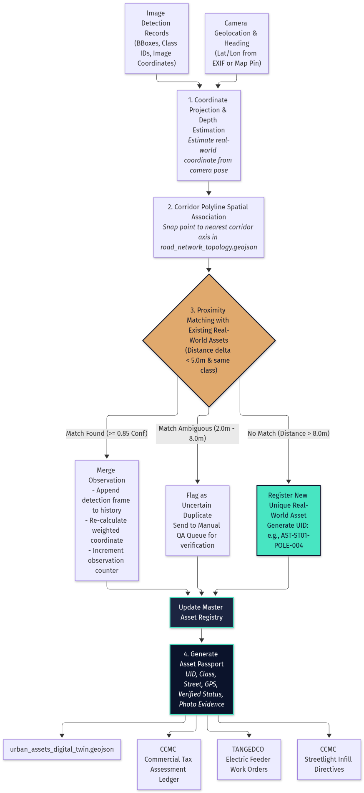

> **Architectural Description**: Shows how 2D bounding boxes and camera coordinates are projected to the ground surface, snapped to corridor vector centerlines, deduplicated using a 5-meter spatial buffer, and exported to GeoJSON layers and municipal work orders.

---

## 8. Data Flow Diagram (Diagram 8)

**File Path**: [`diagrams/08_data_flow.png`](file:///D:/farm%20ai/project_documentation/diagrams/08_data_flow.png)  
**Mermaid Source**: [`diagrams/08_data_flow.mmd`](file:///D:/farm%20ai/project_documentation/diagrams/08_data_flow.mmd)

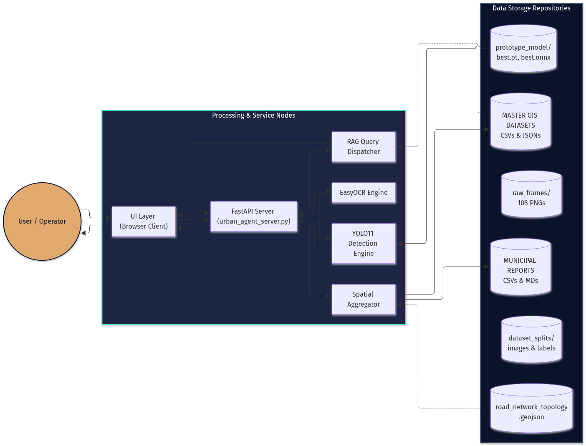

> **Architectural Description**: Details the movement of images, model weights, detection tensors, text crops, spatial feature collections, and conversational queries between user clients, FastAPI processing services, and persistent file stores.

---

## 9. API and Backend Request Flow (Diagram 9)

**File Path**: [`diagrams/09_api_flow.png`](file:///D:/farm%20ai/project_documentation/diagrams/09_api_flow.png)  
**Mermaid Source**: [`diagrams/09_api_flow.mmd`](file:///D:/farm%20ai/project_documentation/diagrams/09_api_flow.mmd)

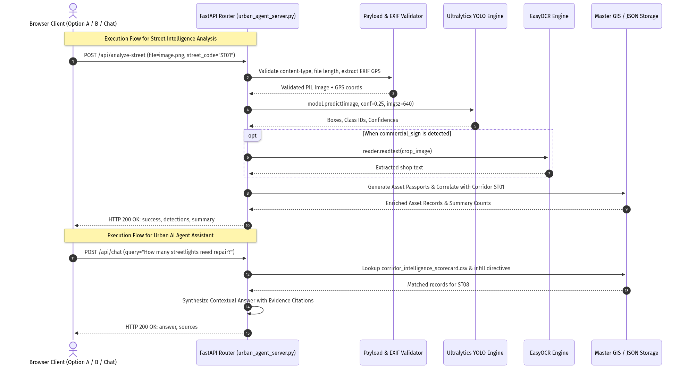

> **Architectural Description**: High-resolution sequence diagram illustrating the exact HTTP message exchange for `POST /api/analyze-street` (image upload, validation, YOLO inference, OCR crop, passport enrichment) and `POST /api/chat` (contextual RAG question answering).

---

## 10. End-to-End User Operational Workflow (Diagram 10)

**File Path**: [`diagrams/10_user_workflow.png`](file:///D:/farm%20ai/project_documentation/diagrams/10_user_workflow.png)  
**Mermaid Source**: [`diagrams/10_user_workflow.mmd`](file:///D:/farm%20ai/project_documentation/diagrams/10_user_workflow.mmd)

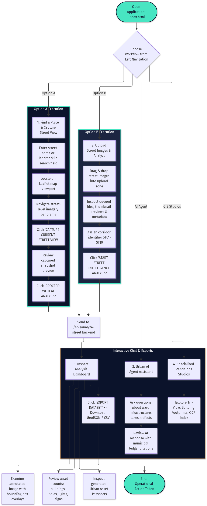

> **Architectural Description**: Operational walkthrough from launching `index.html` through selecting Option A or Option B, reviewing detection overlays and asset passports, asking questions to the Urban AI Agent, and downloading GeoJSON/CSV exports.

---

## 11. Error Handling and Quality Assurance (Diagram 11)

**File Path**: [`diagrams/11_quality_assurance.png`](file:///D:/farm%20ai/project_documentation/diagrams/11_quality_assurance.png)  
**Mermaid Source**: [`diagrams/11_quality_assurance.mmd`](file:///D:/farm%20ai/project_documentation/diagrams/11_quality_assurance.mmd)

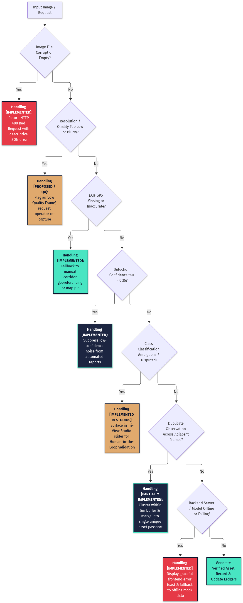

> **Architectural Description**: Decision tree specifying how FarmwiseAI handles corrupted image payloads (HTTP 400), low-confidence predictions ($\tau < 0.25$), ambiguous class labels (Tri-View slider review), missing EXIF GPS (corridor map fallbacks), and backend service disconnects.

---

## 12. Deployment Architecture (Diagram 12)

**File Path**: [`diagrams/12_deployment_architecture.png`](file:///D:/farm%20ai/project_documentation/diagrams/12_deployment_architecture.png)  
**Mermaid Source**: [`diagrams/12_deployment_architecture.mmd`](file:///D:/farm%20ai/project_documentation/diagrams/12_deployment_architecture.mmd)

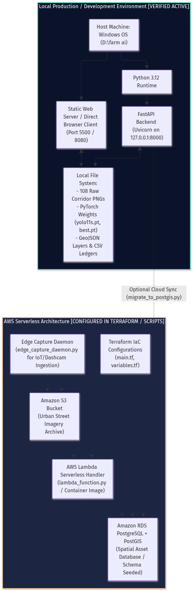

> **Architectural Description**: Displays the active local Windows runtime environment (Python 3.12, FastAPI on port 8000, Static web server on port 5500, local file stores) alongside the configured AWS Serverless cloud architecture (Terraform modules, S3 ingestion bucket, Lambda inference handler, and RDS PostGIS database).

---

## 13. VLM $\to$ LLM Guided YOLO Training & Distillation Flowchart (Diagram 13)

**File Path**: [`diagrams/13_vlm_llm_guided_yolo_training.png`](file:///D:/farm%20ai/project_documentation/diagrams/13_vlm_llm_guided_yolo_training.png)  
**Mermaid Source**: [`diagrams/13_vlm_llm_guided_yolo_training.mmd`](file:///D:/farm%20ai/project_documentation/diagrams/13_vlm_llm_guided_yolo_training.mmd)

> **Architectural Description**: Detailed 5-phase flowchart answering the examiner's architectural mandate:
> 1. **Phase 1 (VLM Visual Understanding)**: Foundation Vision-Language Model (Qwen2-VL / Florence-2 / PaliGemma) conducts open-vocabulary reasoning across complex urban street imagery, discovering hidden utilities, cable nests, leaning angles, and signage semantics.
> 2. **Phase 2 (LLM Reasoning & Structured Priors)**: High-level LLM parses multimodal observations into structured candidate bounding boxes, disambiguated class IDs, condition parameters, and region-of-interest (ROI) masks.
> 3. **Phase 3 (Teacher-Student Distillation)**: Automated pseudo-label generator creates YOLO formatted labels with a confidence/ambiguity gating filter and human-in-the-loop QA via Tri-View Studio.
> 4. **Phase 4 (YOLO Fine-Tuning & Training Loop)**: Base YOLO11 model is fine-tuned on the VLM-enriched ground truth, learning subtle urban features across 100 epochs, validated against unseen test corridors (ST09 & ST10).
> 5. **Phase 5 (Dual-Speed Hybrid Production Inference)**: Lightweight fine-tuned YOLO11 runs at edge speed (30–60 FPS, ~25ms latency), falling back to the heavy VLM/LLM only on ambiguous visual edge cases.
