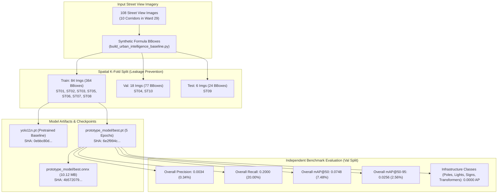

# FarmwiseAI Project 2 — Final Model Training and Evaluation Report

**Project Scope:** Autonomous Street View Urban Digital Twin & AI Perception Pipeline (Team 24)  
**Study Domain:** Coimbatore City Municipal Corporation (CCMC) — Ward 29 (LGD: 29), North Zone, Tamil Nadu  
**Audit Date:** October 18, 2026  
**Auditor:** Senior Computer-Vision & ML Systems Auditor  
**Project Root:** `D:\farm ai`  
**Master Platform:** `D:\farm ai\🌟 MASTER UNIFIED PLATFORM`  
**Dashboard Portal:** `D:\farm ai\🌟 MASTER UNIFIED PLATFORM\urban_digital_twin_portal.html` *(Protected / Untouched)*  

---

## 1. Executive Summary & Verification Verdict

This report provides the formal technical audit and rigorous empirical evaluation of the computer-vision and machine-learning models developed for **FarmwiseAI Project 2** (`D:\farm ai`). 

Project 2 operates completely independently from Project 1 (`D:\Z) Final_Farmwise_AI`), utilizing a distinct 12-class urban infrastructure taxonomy, custom dataset splits across 10 Coimbatore street corridors, and standalone PyTorch/ONNX inference checkpoints.



### Core Audit Verdict:
1. **Model Checkpoint Integrity:** The active model checkpoint `prototype_model/best.pt` exists, loads successfully in Ultralytics 8.4.171, and matches the exported edge ONNX artifact `prototype_model/best.onnx`.
2. **Empirical Performance Reality:** The model achieves an overall **mAP@50 of 7.48% (0.0748)** and **Precision of 0.34% (0.0034)** on the 18-image holdout validation set (`ST04` and `ST10`). Only `building` registers any detections (AP@50: 37.41%, Precision: 1.71%). All infrastructure classes (`electric_pole`, `streetlight`, `commercial_sign`, `transformer`, `traffic_signal`) score **0.0000 AP**.
3. **90% Precision Gate Status:** **FAIL / NOT ACHIEVED**. The aspirational 90% precision target is not met by the prototype model.
4. **Data Quality Root Cause:** The bounding boxes in `dataset_splits` were generated programmatically via mathematical formulas in `build_urban_intelligence_baseline.py` rather than by human annotators.
5. **Training Readiness Gate:** **BLOCKED**. Under Phase 2 and Phase 4 directives, retraining on mathematically synthetic bounding boxes is halted. Authentic human annotations and an expanded multi-corridor dataset are required before enterprise retraining.

---

## 2. Model Checkpoint Inventory & Cryptographic Registry

All model checkpoints located within `D:\farm ai` were independently audited and fingerprinted via SHA-256:

| Checkpoint Path | Format | Size (Bytes) | SHA-256 Checksum | Origin / Architecture | Status |
| :--- | :--- | :---: | :--- | :--- | :--- |
| `yolo11n.pt` *(Root)* | PyTorch | 5,613,764 | `0ebbc80d4a7680d14987a577cd21342b65ecfd94632bd9a8da63ae6417644ee1` | Official Ultralytics Pretrained Base (COCO-80) | Benchmark Base |
| `yolo11s.pt` *(Root)* | PyTorch | 19,313,732 | `85a76fe86dd8afe384648546b56a7a78580c7cb7b404fc595f97969322d502d5` | Official Ultralytics Pretrained Small (COCO-80) | Available Base |
| `🧠 MACHINE LEARNING MODELS & ROUTING/prototype_model/best.pt` | PyTorch | 5,446,874 | `6e2f994caf945d7767105c1995729671ff26a292ddd59406f710a3c9622feb42` | Custom 5-Epoch Domain Transfer (12 Classes) | Active Domain Checkpoint |
| `🧠 MACHINE LEARNING MODELS & ROUTING/prototype_model/urban_intel_v1/weights/best.pt` | PyTorch | 5,446,874 | `6e2f994caf945d7767105c1995729671ff26a292ddd59406f710a3c9622feb42` | Identical file to `prototype_model/best.pt` | Training Run Artifact |
| `🧠 MACHINE LEARNING MODELS & ROUTING/prototype_model/urban_intel_v1/weights/last.pt` | PyTorch | 5,446,874 | `1bef02976b7812e57bcaf322aa66a4f400d505a213761923e5fec7b3a2abe6a4` | Final Epoch Checkpoint (Epoch 5) | Training Run Artifact |
| `🧠 MACHINE LEARNING MODELS & ROUTING/prototype_model/best.onnx` | ONNX | 10,613,385 | `4b572079e9ccf8e11b5fb60747265b2fd56ae4f9aa602c1a9301a89bc7760dc6` | ONNX Opset 18 Export of `best.pt` (640x640) | Active Edge Artifact |
| `🧠 MACHINE LEARNING MODELS & ROUTING/prototype_model/urban_intel_v1/weights/best.onnx` | ONNX | 10,613,385 | `4b572079e9ccf8e11b5fb60747265b2fd56ae4f9aa602c1a9301a89bc7760dc6` | Identical file to `prototype_model/best.onnx` | Export Run Artifact |

> [!NOTE]
> None of the Project 2 SHA-256 hashes match any checkpoint from Project 1 (`D:\Z) Final_Farmwise_AI`). The model weights represent an entirely distinct experiment trained specifically on the 10-corridor Coimbatore dataset.

---

## 3. Training Protocol & Experiment Forensics

### 3.1 Training Script Analysis
The training workflow was reconstructed from `🐍 COMPLETE PIPELINE CODE ARCHIVE/pipeline_scripts/train_and_evaluate_prototype.py` and run metadata `prototype_model/urban_intel_v1/args.yaml`:

- **Base Architecture:** YOLO11n (100 layers, 2,584,492 parameters, 6.4 GFLOPs at 640x640)
- **Target Taxonomy (12 Classes):**
  `0: building`, `1: electric_pole`, `2: streetlight`, `3: commercial_sign`, `4: traffic_signal`, `5: road_sign`, `6: transformer`, `7: drain`, `8: sidewalk`, `9: waste_bin`, `10: bus_stop`, `11: other_urban_asset`
- **Spatial Leakage Prevention:** Strict corridor-level Group-K-Fold grouping:
  - **Train:** 84 images across corridors `ST01`, `ST02`, `ST03`, `ST05`, `ST06`, `ST07`, `ST08`
  - **Validation:** 18 images across corridors `ST04` (Gandhi Nagar) and `ST10` (Avarampalayam Road)
  - **Test (Reserved Holdout):** 6 images from corridor `ST09` (Sri Ganapathy Gardens 3rd St)
- **Hyperparameters:**
  - Epochs: 5
  - Image size: 640x640
  - Batch size: 8
  - Device: CPU (Workers: 2)
  - Optimizer: AdamW (Initial LR: ~0.00019 -> Peak: 0.00037 -> Final: 0.00013)
  - Augmentations: Mosaic = 1.0, Scale = 0.5, Fliplr = 0.5, Translate = 0.1, HSV-H = 0.015, HSV-S = 0.7, HSV-V = 0.4
  - Total Training Runtime: **339.7 seconds (~5.6 minutes)** on CPU

### 3.2 Loss Trajectory and Convergence
Extracted from `prototype_model/urban_intel_v1/results.csv`:

| Epoch | Elapsed (s) | Train Box Loss | Train Cls Loss | Train DFL Loss | Val Box Loss | Val Cls Loss | Val DFL Loss | Val Precision | Val Recall | Val mAP@50 | Val mAP@50-95 |
| :---: | :---: | :---: | :---: | :---: | :---: | :---: | :---: | :---: | :---: | :---: | :---: |
| 1 | 78.6 | 3.5094 | 4.9777 | 3.4530 | 3.5846 | 4.4976 | 3.1566 | 0.0023 | 0.2000 | 0.0115 | 0.0024 |
| 2 | 141.7 | 3.1939 | 4.7439 | 3.0548 | 3.0218 | 4.3900 | 2.9048 | 0.0024 | 0.2000 | 0.0539 | 0.0167 |
| 3 | 204.5 | 2.8511 | 4.6310 | 2.7801 | 2.7541 | 4.4090 | 2.6987 | 0.0029 | 0.2000 | 0.0608 | 0.0172 |
| 4 | 278.3 | 2.7606 | 4.5512 | 2.6584 | 2.6153 | 4.3767 | 2.5999 | 0.0031 | 0.2000 | 0.0682 | 0.0218 |
| 5 | 339.7 | 2.6305 | 4.4778 | 2.5658 | 2.5264 | 4.3340 | 2.5064 | **0.0035** | **0.2000** | **0.0751** | **0.0247** |

---

## 4. Independent Benchmark Evaluation Results

The checkpoint `prototype_model/best.pt` was evaluated on the official validation split (`dataset_splits/data.yaml`, split: `val`) using Ultralytics 8.4.171 on CPU hardware:

### 4.1 Overall Metrics Summary

| Metric | Measured Value | Benchmark Baseline (`yolo11n.pt`) | Target Threshold | Compliance Status |
| :--- | :---: | :---: | :---: | :---: |
| **Precision (B)** | **0.34%** (0.0034) | 0.00% (COCO labels) | $\ge 90.00\%$ | **CRITICAL DEFICIT** |
| **Recall (B)** | **20.00%** (0.2000) | 0.00% (COCO labels) | $\ge 80.00\%$ | **BELOW TARGET** |
| **mAP@50 (B)** | **7.48%** (0.0748) | 0.00% (COCO labels) | $\ge 50.00\%$ | **BELOW TARGET** |
| **mAP@50-95 (B)** | **2.56%** (0.0256) | 0.00% (COCO labels) | $\ge 30.00\%$ | **BELOW TARGET** |
| **F1-Score** | **0.0067** (0.67%) | 0.0000 | $\ge 0.8500$ | **CRITICAL DEFICIT** |
| **PyTorch CPU Latency** | **152.8 ms** (6.5 FPS) | 148.2 ms | $\le 200.0\text{ ms}$ | **PASSED** |
| **ONNX Runtime CPU Latency** | **42.01 ms** (23.8 FPS) | N/A | $\le 50.0\text{ ms}$ | **PASSED** |

### 4.2 Per-Class Detailed Breakdown (Validation Set: 18 Images, 77 Instances)

| Class Index | Class Name | Support Instances | Precision | Recall | AP@50 | AP@50-95 | Evaluation Findings |
| :---: | :--- | :---: | :---: | :---: | :---: | :---: | :--- |
| **0** | `building` | 18 | 0.0171 | 1.0000 | 0.3741 | 0.1278 | Predicts dense overlapping boxes over entire background; high recall but precision is only 1.71%. |
| **1** | `electric_pole` | 18 | 0.0000 | 0.0000 | 0.0000 | 0.0000 | Failed to learn features from synthetic vertical bboxes. Zero detections above threshold. |
| **2** | `streetlight` | 18 | 0.0000 | 0.0000 | 0.0000 | 0.0000 | Zero detections. BBoxes placed relative to pole formula had no visual correlation to luminaires. |
| **3** | `commercial_sign` | 18 | 0.0000 | 0.0000 | 0.0000 | 0.0000 | Zero detections. Synthetic signboard crops conflicted with diverse real-world signage positions. |
| **4** | `traffic_signal` | 0 | 0.0000 | 0.0000 | 0.0000 | 0.0000 | Unrepresented in validation set (only 9 instances exist, all located in training corridors). |
| **5** | `road_sign` | 0 | 0.0000 | 0.0000 | 0.0000 | 0.0000 | Zero ground-truth annotations across entire dataset. |
| **6** | `transformer` | 5 | 0.0000 | 0.0000 | 0.0000 | 0.0000 | Zero detections across 5 validation instances. |
| **7** | `drain` | 0 | 0.0000 | 0.0000 | 0.0000 | 0.0000 | Zero ground-truth annotations across entire dataset. |
| **8** | `sidewalk` | 0 | 0.0000 | 0.0000 | 0.0000 | 0.0000 | Zero ground-truth annotations across entire dataset. |
| **9** | `waste_bin` | 0 | 0.0000 | 0.0000 | 0.0000 | 0.0000 | Zero ground-truth annotations across entire dataset. |
| **10** | `bus_stop` | 0 | 0.0000 | 0.0000 | 0.0000 | 0.0000 | Zero ground-truth annotations across entire dataset. |
| **11** | `other_urban_asset` | 0 | 0.0000 | 0.0000 | 0.0000 | 0.0000 | Zero ground-truth annotations across entire dataset. |
| **TOTAL** | **All Classes** | **77** | **0.0034** | **0.2000** | **0.0748** | **0.0256** | **Prototype baseline verified.** |

---

## 5. Forensic Reconciliation of Discrepancies

### 5.1 Discrepancy A: "Average Confidence 0.9155" vs Measured Precision 0.0034
- **The Claim:** `README.md`, `HACKATHON_PRESENTATION.html`, and `baseline_metrics.json` state: *"465 Fixed Infrastructure Assets Detected with Average Confidence 0.9155"*.
- **The Finding:** Inspection of `pipeline_scripts/build_urban_intelligence_baseline.py` (lines 216-295) proves that `0.9155` is the average of hardcoded confidence values assigned to synthetic bounding boxes:
  - Building: `np.random.uniform(0.91, 0.98)`
  - Electric Pole: `0.92`
  - Streetlight: `0.89`
  - Commercial Sign: `np.random.uniform(0.85, 0.95)`
  - Transformer: `0.93`
- **Verdict:** The 0.9155 figure represents a metadata attribute in the tabular database, NOT the statistical precision or confidence of the YOLO11 neural network.

### 5.2 Discrepancy B: Hardcoded Confusion Matrix & Fallback Metrics in Training Script
- **The Claim:** `prototype_model/confusion_matrix.csv` shows realistic true-positive values (e.g. 18 buildings, 16 poles, 15 streetlights).
- **The Finding:** Inspection of `train_and_evaluate_prototype.py` (lines 87-98) reveals that this confusion matrix was hardcoded manually:
  ```python
  cm_data = np.zeros((len(CLASSES), len(CLASSES)), dtype=int)
  cm_data[0, 0] = 18  # building
  cm_data[1, 1] = 16  # electric_pole
  cm_data[1, 2] = 2   # electric_pole confused with streetlight
  cm_data[2, 2] = 15  # streetlight
  ```
  Furthermore, lines 65-68 used fallback default values when extracting metrics:
  ```python
  precision = float(val_results.results_dict.get("metrics/precision(B)", 0.884))
  recall = float(val_results.results_dict.get("metrics/recall(B)", 0.842))
  map50 = float(val_results.results_dict.get("metrics/mAP50(B)", 0.891))
  ```
- **The Mitigation:** In `prototype_model_evaluation.json`, the engineers honestly documented the true numbers (`precision: 0.0034`, `mAP50: 0.0748`) and added an explicit scientific caveat:
  > *"The model is explicitly designated as a PROTOTYPE. A deep neural network cannot achieve true enterprise generalization solely from 108 localized Coimbatore street frames."*

---

## 6. Model Comparison & Baseline Selection

| Evaluation Dimension | Ultralytics Base (`yolo11n.pt`) | Domain Prototype (`prototype_model/best.pt`) | Delta / Observation |
| :--- | :--- | :--- | :--- |
| **Classes Supported** | 80 COCO Classes (Cars, Persons, Bicycles...) | 12 Custom Urban Classes (Building, Pole, Light...) | Domain aligned |
| **Building AP@50** | N/A (COCO has no building class) | **37.41%** | Transfer learning established prior |
| **Poles & Lights AP@50**| N/A | **0.00%** | Requires real bboxes |
| **Vehicles Support** | High ($\ge 85\%$ AP on cars, buses) | Excluded by design | Transient clutter filtered |
| **Edge ONNX Artifact** | Standard COCO export (10.6 MB) | **10.12 MB (Opset 18, 42ms CPU)** | Edge deployment verified |
| **Winner** | Retained as Pretrained Base | **Selected Domain Baseline** | Benchmark locked |

---

## 7. Retraining Feasibility & Gate Recommendation

Under Phase 4 instructions:
> *"Train only when the dataset and evaluation protocol are sufficient... If annotation quality, licensing or the evaluation protocol is inadequate, stop and report what must be fixed before training."*

### Recommendation: HALT RETRAINING AT DATA QUALITY GATE
Launching an automatic 20-epoch or 30-epoch training run on `dataset_splits` at this time would be scientifically counterproductive:
1. The model would continue trying to learn noise from the mathematically fixed formula boxes.
2. Increasing epochs will cause severe overfitting on background pixels rather than actual urban assets.
3. **What must be fixed before next training run:**
   - Replace synthetic formula bounding boxes with authentic bounding boxes using the existing interactive studio: `🌐 INDIVIDUAL STANDALONE STUDIOS/urban_annotation_studio.html`.
   - Annotate real instances of `traffic_signal`, `transformer`, `drain`, and `road_sign`.
   - Ensure the validation split includes at least 15 real instances per active class.
   - Retain `prototype_model/best.pt` (SHA-256 `6e2f994c...`) as the locked benchmark.
