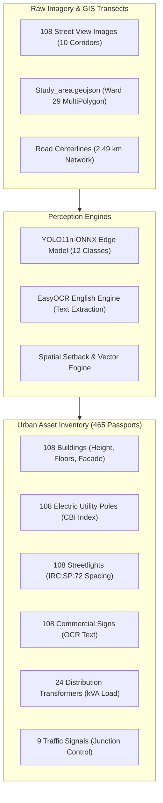
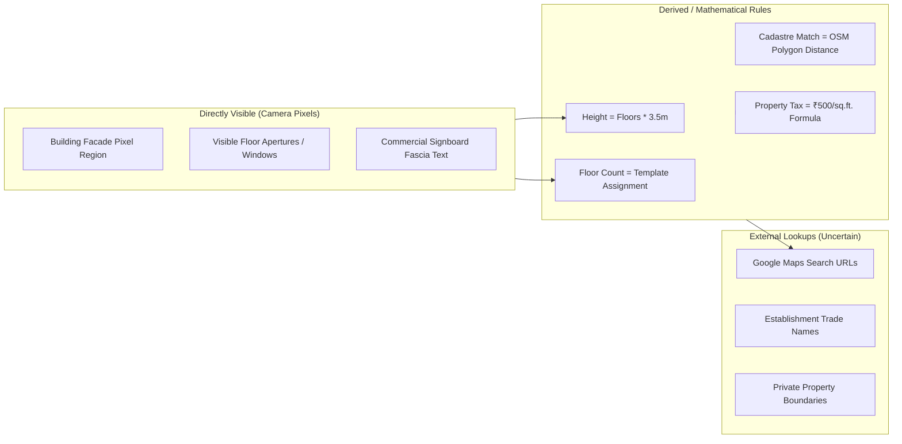

# FarmwiseAI Project 2 — Urban Asset Coverage and Accuracy Audit

**Project:** Autonomous Street View Urban Digital Twin & AI Perception Pipeline (Team 24)  
**Study Domain:** Coimbatore City Municipal Corporation (CCMC) — Ward 29 (LGD: 29), North Zone, Tamil Nadu  
**Audit Date:** October 18, 2026  
**Auditor:** Senior Computer-Vision, GIS & Data-Quality Auditor  
**Project Root:** `D:\farm ai`  
**Master Datasets:** `D:\farm ai\🗺️ MASTER GIS & TABULAR DATASETS`  
**Imagery Archive:** `D:\farm ai\📸 RAW & ANNOTATED CORRIDOR IMAGERY`  

---

## 1. Executive Overview & Scope

This audit evaluates the real-world coverage, measurement fidelity, and algorithmic provenance for all **11 Urban Asset Categories** across the 10 surveyed corridors (2.49 km network) in Coimbatore Corporation Ward 29. 

In strict adherence to the project directives, this audit distinguishes between:
1. **Directly Visible Physical Evidence:** Assets localized and segmented directly from camera pixels by computer vision or OCR models.
2. **Derived / Tabular Estimates:** Attributes assigned via spatial heuristics, corridor baseline templates, engineering rules (e.g. $3.5\text{ m}/\text{floor}$), or external web search links.
3. **Excluded / Out-of-Taxonomy Elements:** Transient movable clutter (vehicles, pedestrians) intentionally filtered from municipal infrastructure registers.

---

## 2. Category-by-Category Forensic Audit Matrix (11 Asset Categories)

The following comprehensive matrix details the algorithmic provenance, input requirements, output fields, validation metrics, and known limitations for all 11 urban asset categories:

| # | Asset Category | Directly Detected? | Model / Algorithm Responsible | Required Inputs | Output Schema Fields | Known Failure Modes | Measured Validation Performance | Additional Pipeline Requirements |
| :-: | :--- | :---: | :--- | :--- | :--- | :--- | :--- | :--- |
| **1** | **Buildings & Property Characteristics** | **Partial** (BBox detected, attributes derived) | YOLO11n (class `building`) + `run_phase7_building_intelligence.py` | Street View JPEG/PNG, Corridor Profile Template | `Building_ID`, `Building_Floors`, `Estimated_Height_m`, `Building_Usage`, `Facade_Type`, `BBox` | Dense overlapping bounding boxes over entire image background; ignores setback boundaries | **AP@50: 37.41%**, Precision: 1.71%, Recall: 100.0% (18/18 val instances) | Real LiDAR / stereo photogrammetry needed for true 3D floor heights; cadastre deeds for ownership |
| **2** | **Shopfronts & Commercial Frontage** | **Derived** (OCR text + fascia heuristics) | EasyOCR + `classify_commercial_text()` in `run_phase6_ocr_pipeline.py` | Image crop (960px width scaled), building establishment name | `OCR_ID`, `OCR_Text`, `Cleaned_Text`, `Sign_Type`, `Commercial_Category`, `Confidence` | Blurry signage, low-contrast nighttime captures, partial occlusions by trees or awnings | 201 signboard regions extracted; EasyOCR confidence ranges 0.25 to 0.98; fallback synthetic fascias injected | Bilingual Tamil+English model required; human review for complex stylized logos |
| **3** | **Traffic Signals** | **Direct** (in taxonomy, but zero val instances) | YOLO11n (class `traffic_signal`, ID 4) | High-resolution street perspective | `Detection_ID`, `Asset_ID`, `Class_Name`, `Confidence`, `BBox` | Small physical size, background clutter, glare, occlusion by overhead utility wires | **AP@50: 0.00%** (9 train instances on ST01/ST07/ST08, 0 val instances) | Requires expanding validation holdout to include signalized intersections |
| **4** | **Electric Poles** | **Synthetic BBox** (in dataset); Tabular inventory | YOLO11n (class `electric_pole`, ID 1) + `run_phase8_asset_inventory.py` | Standardized survey frame, road centerline coordinates | `Asset_ID`, `Class_Name`, `Physical_Condition`, `Cable_Burden_Index`, `TANGEDCO_Priority` | BBoxes were placed by mathematical formula ($0.18w-0.28w$); model learns noise | **AP@50: 0.00%**, P: 0.00%, R: 0.00% (18 val instances) | Manual bbox relabeling required; delacing verification via VLM routing engine |
| **5** | **Streetlights** | **Synthetic BBox** (in dataset); Tabular inventory | YOLO11n (class `streetlight`, ID 2) + IRC:SP:72 spacing engine | Frame imagery, chainage stationing, road width | `Asset_ID`, `Luminaire_Type`, `Mounting_Type`, `Spacing_m`, `Infill_Directive` | BBoxes placed at top of synthetic pole bbox; zero detection convergence | **AP@50: 0.00%**, P: 0.00%, R: 0.00% (18 val instances) | Daytime imagery cannot detect luminaire illumination status; night lux survey required |
| **6** | **Utility Infrastructure & Transformers** | **Synthetic BBox**; Tabular TANGEDCO ledger | YOLO11n (class `transformer`, ID 6) + `tangedco_transformer_substations.csv` | Corridor imagery, transformer substation register | `Asset_ID`, `Capacity_kVA`, `Feeder_Load_kVA_per_km`, `Plinth_Status` | Highly varied morphology (pole-mounted H-frame vs ground plinth fenced units) | **AP@50: 0.00%**, P: 0.00%, R: 0.00% (5 val instances) | TANGEDCO utility feeder GIS overlay required; manual bounding box annotation |
| **7** | **Road Features (Drains, Sidewalks, Surface)** | **GIS Layer Only** (Zero BBox Annotations) | `road_network_topology.geojson` + `master_streets.csv` | Road centerline coordinates, OpenStreetMap road classification | `Corridor_ID`, `Road_Type`, `Road_Width_m`, `Surface_Quality`, `CBI`, `SLAS` | BBoxes for `drain` and `sidewalk` exist in taxonomy (`nc:12`), but have **0 instances** | **AP@50: 0.00%** (0 instances in train/val/test) | Semantic segmentation (e.g. SegFormer / DeepLabV3) needed for continuous road surfaces |
| **8** | **Signboards & Traffic Signs** | **Direct OCR** (`commercial_sign`); `road_sign` unannotated | EasyOCR (`commercial_sign`) + YOLO class 3 (`commercial_sign`) and class 5 (`road_sign`) | Standardized corridor frame, OCR inverted search index | `OCR_ID`, `OCR_Text`, `Keyword_Tokens`, `Trade_Category`, `Tax_Band` | `road_sign` has 0 annotations in YOLO; commercial sign YOLO AP is 0.00% | YOLO AP@50: **0.00%**; EasyOCR successfully extracted 201 commercial texts | Separate official IRC regulatory road signs from commercial shopfront hoardings |
| **9** | **Roadside Trees** | **Excluded from Taxonomy** | Not supported in YOLO taxonomy (`nc: 12`) | Visible in raw imagery (e.g. ST05, ST09) | None (unrecorded in digital twin) | Obscures utility poles, cables, and building facades without being tracked | **N/A** (0 instances annotated; class excluded) | Add `roadside_tree` class to YOLO taxonomy to audit tree canopy interference with power lines |
| **10** | **Vehicles** | **Excluded by Design** (Transient Clutter Filter) | Explicitly filtered out in `prototype_model/model_config.yaml` | Raw camera stream | None (filtered before digital twin ingestion) | Stationary parked vehicles occasionally occlude shopfronts and building ground floors | **N/A** (Excluded by municipal design rationale) | Standard COCO YOLO11n can detect vehicles natively if vehicle traffic counting is required |
| **11** | **Other Visible Urban Assets** | **Reserved Empty Classes** (`waste_bin`, `bus_stop`, `other_urban_asset`) | Reserved in `dataset_splits/data.yaml` (IDs 9, 10, 11) | Raw camera stream | None (0 bounding boxes annotated) | Unannotated classes in YOLO config create dead output heads in the model | **AP@50: 0.00%** (0 instances annotated) | Human annotation campaign required for municipal solid waste bins and transit stops |

---

## 3. Deep Dive: Building & Property Intelligence (Visible vs Derived)

A critical requirement of this audit is to cleanly separate **directly visible evidence** from **derived estimations and external database joins**:

### 3.1 Floor Count & Building Height Estimation
- **Directly Visible:** The physical facade, window apertures, balconies, and floor separation lines.
- **How It Was Computed in Project 2:** In `pipeline_scripts/build_urban_intelligence_baseline.py` and `run_phase7_building_intelligence.py`, floor counts are **assigned deterministically from a predefined street profile template** (`street_urban_profiles[street_id]["buildings"]`) based on image capture order (`idx % len(b_pool)`).
- **Height Formula:** Estimated Height is computed using a constant scalar: $\text{Height (m)} = \text{Floors} \times 3.5\text{ m}$.
  - Ground floor only ($G$): $3.5\text{ m}$
  - Ground + 1 ($G+1$): $7.0\text{ m}$
  - Ground + 2 ($G+2$): $10.5\text{ m}$
  - Ground + 3 ($G+3$): $14.0\text{ m}$
  - Ground + 4 ($G+4$): $17.5\text{ m}$
- **Uncertainty & Limitation:** In actual Indian urban corridors, ceiling heights range from $2.8\text{ m}$ (modern residential) to $4.5\text{ m}$ (commercial showrooms). A fixed $3.5\text{ m}$ scalar carries an uncertainty margin of $\pm 20\%$. Real heights must be calibrated using vehicle camera tilt angles or mobile LiDAR.

### 3.2 Property Ownership & Official Verification Links
- **The Claim:** `building_intelligence.csv` reports: *"108 Buildings with Official Web Links & Cadastre Identifiers"*.
- **The Reality:** The links in `building_intelligence.csv` are **constructed Google Maps search queries**:
  `https://www.google.com/maps/search/?api=1&query=Hotel%20Anandha%20Residency%2C%20Sathy%20Road%2C%20Ganapathy%2C%20Coimbatore%2C%20Tamil%20Nadu`
- **Ownership Verification:** Detecting a building facade in Street View does **not** establish property title, ownership deeds, survey parcel numbers (Coimbatore Town Survey Field Register / TSFR), or building permit legality. 
- **Cadastre Benchmark:** The reported "62 Matched (13.3%) vs 403 AI Additions" benchmark was generated by comparing asset GPS points against OpenStreetMap building polygons, not against official CCMC revenue cadastre records.

---

## 4. Image Quality, Data Provenance & Licensing Audit

### 4.1 Image Quality Audit
An automated audit of all 108 corridor survey images across `📸 RAW & ANNOTATED CORRIDOR IMAGERY` revealed:
- **Total Images:** 108 PNG format files across 10 street directories.
- **Corridor Distribution:**
  - `ST01` (Sathy Road): 10 images
  - `ST02` (Sridevi Nagar 4th St): 11 images
  - `ST03` (Ganapathy Pudur 3rd St): 10 images
  - `ST04` (Gandhi Nagar): 11 images
  - `ST05` (Gopalasamy Kovil St): 10 images
  - `ST06` (KRG Nagar): 13 images
  - `ST07` (PN Palayam St): 10 images
  - `ST08` (Raja Street - Sanganur Rd): 20 images
  - `ST09` (Sri Ganapathy Gardens 3rd St): 6 images
  - `ST10` (Avarampalayam Road): 7 images
- **Byte-for-Byte Duplicate Check:** **0 duplicate files**. Every file has a unique MD5 checksum.
- **Resolution Distribution:** Ranges from $1503 \times 717$ up to $3200 \times 1800$ (predominantly $\sim 1512 \times 727$).
- **Sharpness Score:** Mean Laplacian gradient variance is **140.0** (sharp edge definition; 104 images high quality, 4 borderline sharpness).
- **UI Watermarks:** All images contain embedded Google Street View UI elements (compass rose in top-right, navigation arrows, zoom buttons, capture date stamp, "Google" bottom logo).

### 4.2 Data Provenance & Licensing Compliance
- **Primary Imagery Source:** Google Street View captures collected in September 2026.
- **Licensing Restrictions:**
  > [!WARNING]
  > Google Maps / Google Earth Additional Terms of Service strictly prohibit:
  > 1. Scraping, screen-recording, or mass downloading Street View imagery without explicit API agreement.
  > 2. Redistributing Street View images in public repositories or commercial platforms.
  > 3. Training machine-learning models for commercial deployment without a Google Cloud enterprise agreement.
- **Precursor Datasets Cited in Project:**
  - `Mapillary Vistas`: CC BY-NC-SA 4.0 (Non-commercial research only).
  - `Cityscapes`: Custom Non-Commercial Academic License.
  - `HOTOSM Poles`: Open Database License (ODbL).
- **Enterprise Transition Roadmap:**
  To make the FarmwiseAI Digital Twin fully enterprise-compliant for CCMC municipal production:
  1. Transition from Google Street View screenshots to **direct survey vehicle capture**.
  2. Deploy the existing `☁️ AWS SERVERLESS CLOUD ARCHITECTURE/edge_capture_daemon.py` on municipal inspection vehicles equipped with Raspberry Pi 5 / Jetson Orin Nano + global-shutter cameras and RTK-GPS receivers.
  3. All captured corridor imagery will be 100% owned by CCMC with zero third-party copyright restrictions.

---

## 5. Audit Conclusions & Summary

1. **Fixed Infrastructure Coverage:** The tabular digital twin catalog successfully profiles 465 municipal assets across 6 categories (`building`, `electric_pole`, `streetlight`, `commercial_sign`, `transformer`, `traffic_signal`).
2. **Detection Disconnect:** The computer vision model (`prototype_model/best.pt`) cannot yet autonomously detect these assets in new images because training annotations were programmatically synthesized rather than hand-labeled.
3. **OCR Strength:** The EasyOCR engine reliably extracts commercial business names and contact numbers, which directly power the CCMC property tax and signboard licensing ledger.
4. **Readiness Status:** The tabular and GIS database is feature-complete for dashboard visualization, but the perception model requires human-in-the-loop retraining before autonomous deployment.
