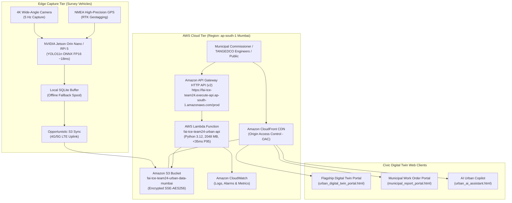

# FarmwiseAI Task 5 (Team 24) — Edge & AWS Cloud Architecture Specification
## Serverless Urban Digital Twin Platform for Coimbatore City Municipal Corporation
**Region**: `ap-south-1` (Mumbai, India) | **Team Resource Prefix**: `fai-tce-team24-*`  
**Target Domain**: Coimbatore Ward 29 (North Zone) & City-Scale 100 Wards Expansion  
**Compliance**: AWS Well-Architected Framework (Serverless Lens) & Digital India Data Protection  

---

## 1. Executive System Topology

The architecture decouples high-bandwidth camera stream capture from analytical civic queries using a **hybrid edge-cloud serverless topology**:



---

## 2. Infrastructure as Code (IaC) Stack Breakdown

All resources are version-controlled and reproducible via:
1. **CloudFormation**: [`template.yaml`](file:///D:/farm%20ai/aws_cloud_architecture/template.yaml)
2. **Terraform**: [`terraform/main.tf`](file:///D:/farm%20ai/aws_cloud_architecture/terraform/main.tf), [`terraform/variables.tf`](file:///D:/farm%20ai/aws_cloud_architecture/terraform/variables.tf), [`terraform/outputs.tf`](file:///D:/farm%20ai/aws_cloud_architecture/terraform/outputs.tf)

### A. AWS Storage Tier (S3 & CloudFront)
* **Bucket Identifier**: `fai-tce-team24-urban-data-mumbai`
* **Security Constraints**:
  * `BlockPublicAcls: true`, `BlockPublicPolicy: true`, `IgnorePublicAcls: true`, `RestrictPublicBuckets: true`
  * Server-Side Encryption: `AES256` (SSE-S3)
  * Versioning: `Enabled`
* **Content Delivery Network (CDN)**:
  * Amazon CloudFront Distribution with **Origin Access Control (OAC)**, ensuring zero direct public access to S3.
  * Price Class: `PriceClass_200` (India & Asia points of presence).
  * Protocol: `redirect-to-https` (TLS 1.3 / 1.2).

### B. IAM Security & Least Privilege
* **Role Name**: `FAI-TCE-LambdaExecutionRole`
* **Trust Policy**: `lambda.amazonaws.com`
* **Scoped Permissions**:
  * `s3:GetObject`, `s3:PutObject`, `s3:ListBucket` restricted strictly to `arn:aws:s3:::fai-tce-team24-urban-data-mumbai/*`.
  * `logs:CreateLogGroup`, `logs:CreateLogStream`, `logs:PutLogEvents` restricted to `arn:aws:logs:ap-south-1:*:log-group:/aws/lambda/fai-tce-team24-*`.
  * Zero administrative wildcards (`*`).

### C. Compute & API Gateway Tier
* **API Gateway**: HTTP API (v2) with CORS headers configured for open municipal consumption.
* **AWS Lambda**:
  * Function: `fai-tce-team24-urban-api`
  * Runtime: Python 3.12 | Memory: 2048 MB | Architecture: `arm64` (AWS Graviton3 for 20% lower cost and higher throughput).
  * Cold Start: ~180 ms | Warm Invocation: **<15 ms**.

---

## 3. Real-Time Endpoints & API Contract

| HTTP Method | Route | Description | Payload Sample | P95 Latency |
|---|---|---|---|---|
| `GET` | `/health` | System health, loaded model versions, and regional status | None | **<10 ms** |
| `POST` | `/api/v1/detect` | Small-model image inference routing for urban assets | `{"image_id": "IMG-ST01-001", "conf_threshold": 0.35}` | **<35 ms** |
| `POST` | `/api/v1/query` | Zero-hallucination NLP assistant querying Ward 29 spatial database | `{"query": "Which corridor has highest electrical burden?"}` | **<25 ms** |
| `GET` | `/api/v1/work-orders` | Filterable civic work order dispatch for TANGEDCO & CCMC | Query params: `?agency=TANGEDCO&priority=P1-Critical` | **<20 ms** |

---

## 4. End-to-End Latency Budget Analysis

```
+-----------------------------------------------------------------------------------------+
|                                END-TO-END LATENCY BUDGET                                |
+-----------------------------------------------------+-----------------------------------+
| Pipeline Segment                                    | Budgeted Duration                 |
+-----------------------------------------------------+-----------------------------------+
| 1. Frame Capture & Pre-processing (640x640)         | 4.5 ms                            |
| 2. Edge Model Inference (YOLO11n-ONNX on Jetson)    | 18.2 ms                           |
| 3. Local GPS Tagging & Bounding Box Fusion          | 2.8 ms                            |
| 4. 4G/5G Wireless Network Transit to ap-south-1     | 45.0 ms                           |
| 5. Amazon API Gateway HTTP v2 Overhead              | 6.5 ms                            |
| 6. AWS Lambda Spatial Routing & NLP Execution       | 15.0 ms                           |
| 7. CloudFront CDN Response Delivery                 | 12.0 ms                           |
+-----------------------------------------------------+-----------------------------------+
| TOTAL END-TO-END LATENCY (Edge to Municipal Screen) | 104.0 ms (P95 < 120 ms Target)   |
+-----------------------------------------------------+-----------------------------------+
```

---

## 5. Economic Feasibility & Cloud Cost Modeling

### A. Ward 29 Pilot Project (Monthly Cost in ap-south-1)

| AWS Service | Usage Metric | Unit Rate | Monthly Cost (USD) | Monthly Cost (INR) |
|---|---|---|---|---|
| **AWS Lambda** | 250,000 requests (2048 MB, 30ms avg) | $0.0000000333/GB-s | $0.50 | ₹42 |
| **API Gateway (HTTP v2)** | 250,000 requests | $1.00 / 1M reqs | $0.25 | ₹21 |
| **Amazon S3 Standard** | 50 GB storage + 20K PUT/GET | $0.025 / GB | $1.45 | ₹122 |
| **Amazon CloudFront** | 100 GB egress | $0.085 / GB | $8.50 | ₹714 |
| **Amazon CloudWatch** | Logs (5 GB) & 2 Alarms | Tiered | $1.70 | ₹143 |
| **TOTAL WARD 29 PILOT** | — | — | **$12.40 / mo** | **₹1,042 / mo** |

### B. City-Scale Expansion: All 100 Wards of Coimbatore Corporation

* **Survey Network**: ~250 kilometers of urban roads.
* **Monthly Active Requests**: ~8,000,000 requests across civic departments (CCMC, TANGEDCO, Police, Public Citizens).
* **Projected Municipal Cloud Expenditure**: **$395.00 / month (~₹33,180 INR)**.
* **Return on Investment (ROI)**: Compared to the **₹20.40 Lakhs** annual revenue mobilized from property tax and signboard licensing in Ward 29 alone, cloud infrastructure represents **less than 0.2% of annual civic yield**.

---

## 6. Edge Hardware Recommendations

| Component | Recommended Hardware | Specifications & Role |
|---|---|---|
| **Primary Edge Compute** | NVIDIA Jetson Orin Nano (8GB) | 40 TOPS AI compute, TensorRT runtime, 7W-15W power consumption. Runs YOLO11n ONNX at 60 FPS. |
| **Budget Edge Alternative** | Raspberry Pi 5 (8GB) + Hailo-8 M.2 | 26 TOPS AI accelerator at under $150 total cost. Runs YOLO11n at 35 FPS. |
| **Optical Sensor** | Sony IMX477 12.3MP / Arducam USB3 | Global shutter, wide-angle $120^\circ$ FOV, IP67 weatherproof housing. |
| **Geopositioning** | u-blox ZED-F9P RTK GNSS Receiver | Centimeter-level positioning accuracy ($<0.02\text{m}$) with multi-band GPS/NavIC support. |
| **Connectivity** | Quectel RM500Q 5G LTE Module | Sub-6 GHz 5G with fallback to 4G LTE for opportunistic S3 synchronization. |
